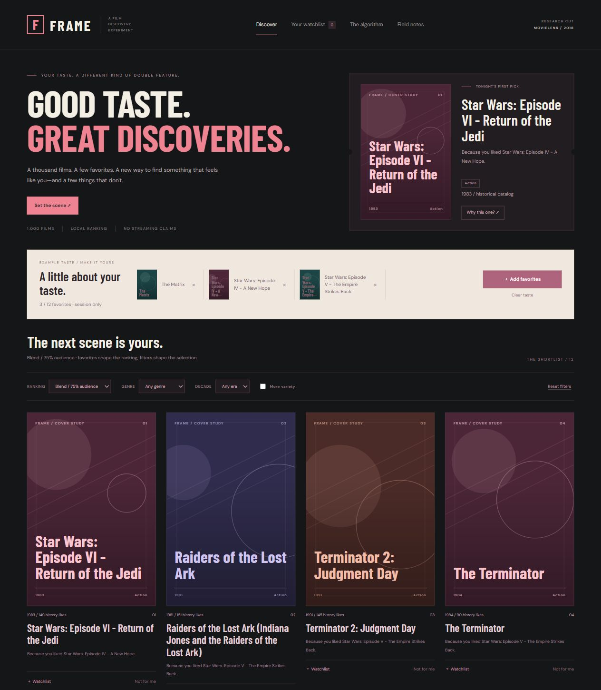

# FRAME / Film Discovery Lab

[](https://github.com/Boody700/frame-recommender/actions/workflows/checks.yml)

**Explainable movie discovery with six rankers, a popularity baseline and offline ranking evaluation.**

[Case study](docs/case-study.md) · [Interview notes](docs/interview-guide.md) · [Validation workflow](.github/workflows/checks.yml)

A complete recommendation-system portfolio project with a cinematic layout: a featured-film ticket, taste ribbon, geometric poster wall, watchlist and visible recommendation reasons.

**[Open the private demo](https://frame-abdelrahman-2026.solarcorgi36.chatgpt.site)**



## Explore

- Replace the clearly labelled example taste with up to twelve favorites from a searchable 1,000-film catalog.
- Compare popularity, genre affinity, sparse item-neighbor ranking and three blends.
- Inspect actual seed-to-candidate audience links and shared genres in a film detail dialog.
- Filter genre/decade, hide unwanted suggestions, or enable an optional genre-diversification pass.
- Save a session-only watchlist. Export/import favorites, watchlist and hidden titles as validated JSON.
- Inspect all six models' offline ranking metrics, catalog restrictions and uncertainty.

No inference API, account, recommendation backend or paid service is required. The app does not provide current streaming availability or predicted star ratings. Every cover is original code-generated artwork, not an official poster.

## Data and result

The fixed **MovieLens latest-small download generated 2018-09-26** contains 100,836 ratings, 610 anonymous users and 9,742 movie entries. This is a development dataset; the source warns it may change and is unsuitable for shared research benchmark claims. Frame is a reproducible educational diagnostic of this fixed download, not a published benchmark or production result.

Each user's ratings are ordered by timestamp, then movie ID for ties. The final floor(10%) is test, the preceding floor(10%) is validation, and the remainder trains. Other users may contribute ratings from later calendar dates: **this is not a global historical replay**. The top 1,000 movies by training likes (ratings ≥4) define a frozen catalog. Previously rated history items are excluded from candidates.

Six fixed rankers are compared. Validation NDCG@10 selects the **75% audience / 20% genre / 5% popularity blend**. All candidates are then refitted on train+validation, keeping test ratings out. The browser uses this same model.

| Selected ranker / fixed local diagnostic | Result |
|---|---:|
| Validation NDCG@10 / 495 eligible users | 0.0921 |
| Test NDCG@10 / 491 eligible users | 0.0836 |
| Test recall@10 | 10.97% |
| Test hit@10 | 30.35% |
| Top-ten catalog exposure | 18.20% |
| Paired NDCG difference vs popularity | +0.0208 |
| Paired 2,000-user-bootstrap interval | [0.0075, 0.0339] |

NDCG is not accuracy. These are restricted-catalog, known-user metrics with sparse observed relevance: 491/610 users qualify; 2,489 of 4,634 test positive events are inside the catalog, and 2,473 enter eligible-user evaluation. Unrated candidates count as non-hits without establishing dislike. The interval is conditional on this fixed setup and is not measured online lift or proof of benefit for new short taste profiles.

## Run the prebuilt app

Node.js 22+; no npm installation is needed.

```powershell
npm start
```

Open `http://127.0.0.1:4178`. Alternatively serve `dist/` using a static HTTP server. Direct file opening will not reliably load JSON modules.

## Reproduce

Python 3.12 is the reference environment; exact versions and source hashes appear in the report.

```powershell
python -m venv .venv
.venv/Scripts/python -m pip install -r requirements.txt
.venv/Scripts/python scripts/download.py
.venv/Scripts/python scripts/train.py
.venv/Scripts/python -m unittest discover -s tests -p "test_*.py"
npm test
```

On Linux/macOS use `.venv/bin/python`. The included small original CSVs and terms permit offline reproduction after dependencies are installed. The downloader also accepts `--archive <path>` for a source ZIP obtained using a verified system downloader. On this Windows environment the bundled Python trust store could not validate GroupLens's certificate chain, so the original ZIP was fetched with Windows `Invoke-WebRequest` using certificate verification, then passed to that option; verification was not disabled. The ZIP itself is not included.

**Eight Python and eight Node checks pass.** JavaScript matches all **2,946 top-ten lists** (six modes × 491 eligible test users); the largest top-item score difference is 5.55e-16. Checks also cover source hashes, temporal partitions, training-only catalog choice, sparse edges, selection, exclusions, cold-profile fallback, diversity constraints, explanation edges and local file validation. GitHub Actions checks the committed browser engine and evaluation fixtures.

## How ranking works

Likes are binary ratings ≥4. Item cosine similarity is shrunk by `coLikes / (coLikes + 10)`; only 40 outgoing neighbors are retained per seed film. A favorite's edges contribute to candidate audience scores. Genre profiles use normalized TF-IDF genre vectors. Each signal is normalized by its query maximum before blending. Scores sort after rounding to twelve decimals, with movie ID as deterministic tie-break.

Empty taste uses popularity regardless of selected mode. The optional variety control reranks the top 100 eligible candidates using 0.8 × base score − 0.2 × maximum genre similarity to already chosen films. It is an exploratory browser feature, excluded from the base-ranker benchmark. Genre/decade/hidden-film exclusions are applied before recommendations are chosen.

The [evaluation figure](reports/evaluation.png) contrasts ranking relevance and catalog exposure. Recreate it with the optional `requirements-report.txt` and `python scripts/plot_report.py`; plotting is not required for training or the browser app.

## Source guide

- [Case study](docs/case-study.md)
- [Model and data card](docs/model-data-card.md)
- [Architecture](docs/architecture.md)
- [Interview guide](docs/interview-guide.md)
- [Validation record](docs/validation.md)
- [Full evaluation](reports/evaluation.json)

Original data: GroupLens Research, University of Minnesota. Cite Harper, F. M. & Konstan, J. A. (2015), *The MovieLens Datasets: History and Context*, ACM TiiS, [DOI 10.1145/2827872](https://doi.org/10.1145/2827872). The source's research/noncommercial and redistribution conditions are preserved in [data/README.txt](data/README.txt) and [third-party notices](THIRD_PARTY_NOTICES.md). MIT applies to original project code, not the dataset. No endorsement is implied.

Read the split, scoring and evaluation code, reproduce the experiment, and explain its limitations before presenting it.


## Development

Independent educational portfolio project. The source, evaluation design and limitations are documented so the work can be inspected and reproduced. GitHub Actions runs the committed browser checks. Python pipeline reproduction uses the commands and data sources described above.
